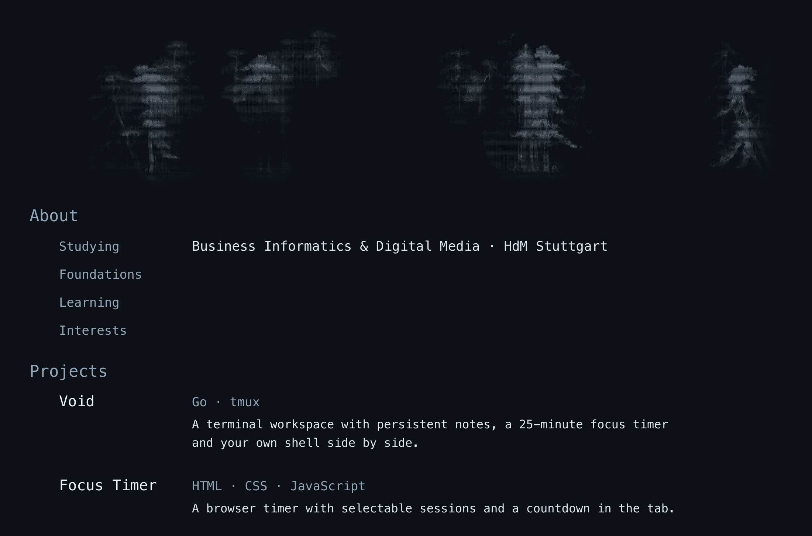

<a href="https://github.com/crnly/void">Void ↗</a> &nbsp;·&nbsp; <a href="https://github.com/crnly/fokus-timer">Focus Timer ↗</a>

Artwork: ASCII adaptation of Hasegawa Tōhaku’s <a href="https://emuseum.nich.go.jp/detail?content_base_id=100151&amp;content_part_id=000&amp;content_pict_id=0&amp;langId=en&amp;webView=">Pine Trees (Shōrin-zu Byōbu)</a>, Tokyo National Museum. Both screens arranged side by side; frames and folding lines removed.
