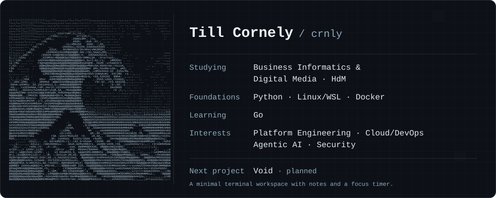

## About

I'm Till, a Business Informatics and Digital Media student at Stuttgart Media University (HdM).
I enjoy turning complex requirements into clear, practical tools.

**Interests:** platform engineering, cloud/DevOps, agentic AI, and security.

Through practical work and university projects, I've gained foundations in **Python, Linux/WSL, and Docker**. I'm currently learning **Go** and the fundamentals of terminal application development.

## Projects

### [Focus Timer](https://github.com/crnly/fokus-timer)

A small HTML, CSS, and JavaScript learning project with selectable session lengths and a countdown in the browser tab.

Practice: reviewing AI-assisted code changes, working with Git branches, and completing pull requests on GitHub.

### Void · Planned

A planned minimal terminal workspace with notes and a focus timer. No finished application yet.

Artwork: ASCII adaptation of Katsushika Hokusai’s <a href="https://www.metmuseum.org/art/collection/search/45434">Under the Wave off Kanagawa</a>, ca. 1830–32. Public-domain image courtesy of The Metropolitan Museum of Art.
